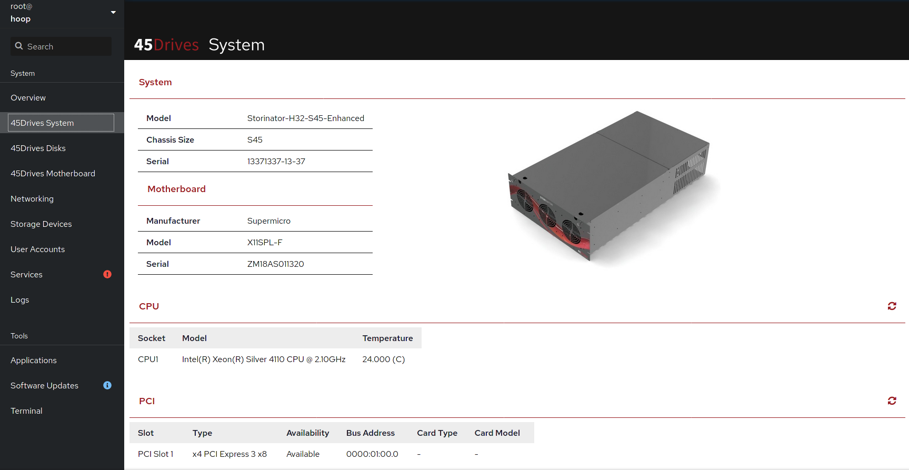
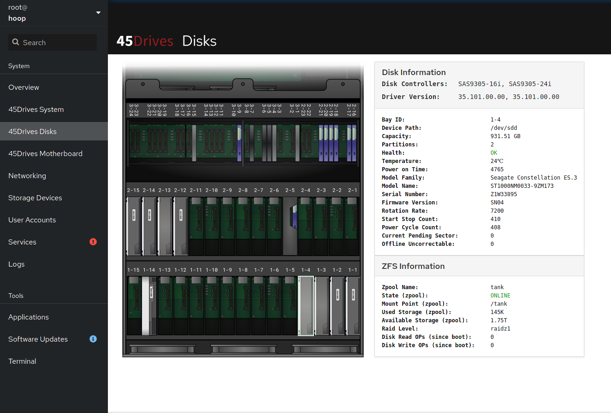
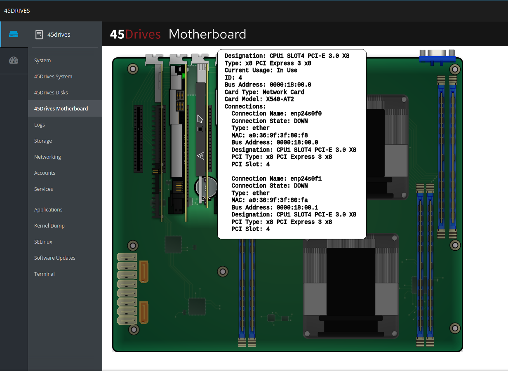
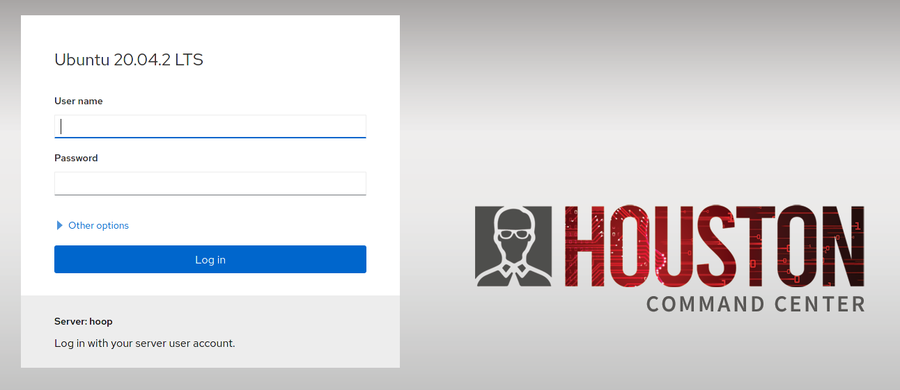

# cockpit-hardware
A cockpit module that displays hardware information for 45Drives storage server products.

## Supported OS
- Rocky Linux
- Ubuntu 20.04.1 LTS (Focal Fossa)

## Features (Version 2.1.1 & up)
### System
  
Lists information about your 45Drives Storinator product including:

* System Information (model, serial and chassis data)
* Motherboard (manufacturer, model and serial numbers)
* CPU (Model and temperature)
* PCI Devices (Speeds, slot numbers, bus addresses, installed cards, and models)
* Memory (Location, Memory Type, Size, Manufacturer, serial and temperature readings)
* Network Information (Connection Names, States, MAC & IP Addresses, and PCI information if detected)
* IPMI address information

### Firmware Updates
Monitors and manages firmware versions for all permanent hardware components in your 45Drives server. Provides:

* **Device Discovery** — Automatically detects HBAs, NICs, NVMe drives, and HDDs with their current firmware versions
* **Update Notifications** — Sidebar badge shows when firmware updates are available (🟡 warning) or reboot needed (🔴 error)
* **Firmware Table** — Lists all detected devices with current version, latest available version, and update status
* **One-Click Updates** — Flash firmware directly from the UI for supported HBAs and NICs. Drive flashing (NVMe, HDD) is planned for a future release.
* **Integrity Verification** — All firmware downloads verified via GPG-signed manifest + SHA256 checksums
* **Safe Operations** — Pre-flight checks prevent flashing during ZFS scrub/rebuild; risky devices (BIOS, BMC) are display-only
* **Automatic Checking** — systemd timer (`45d-firmware-check.timer`) runs daily to check for updates

#### Firmware Architecture
```
fw.45drives.com (GPG-signed manifest.json + firmware files)
        │
        ▼ firmware-check (gpgv verify → version compare)
/var/cache/45drives/firmware/status.json
        │
        ▼ firmware-flash (SHA256 verify → flash tool execute)
Device firmware updated
```

#### Supported Device Categories
| Category | Vendors | Flash Tool | Status |
|----------|---------|------------|--------|
| HBA | Broadcom (9305, 9361, 9400, 9600, 9660) | storcli64, storcli2 | ✅ Flash enabled |
| NIC | NVIDIA/Mellanox ConnectX-5, Broadcom NetXtreme, Intel E810 | mlxup, bnxtnvm, nvmupdate64e | ✅ Flash enabled |
| NVMe | Micron 7400, 7450 | nvme-cli | 🔍 Detection only |
| HDD | Seagate Exos (X14–X24, 2X18) | SeaChest_Firmware | 🔍 Detection only |

Onboard ASRock Rack NICs (including those on ROMED8 and GENOAD8 boards) require
ASRock-signed firmware packages. They remain in the discovered inventory but are
excluded from generic firmware updates and notifications. Detection uses the
board identity with PCI onboard information, or the NIC's ASRock subsystem ID;
retail add-on cards remain eligible. The flasher checks live hardware as well as
the cache. Intel NVM updates select a single adapter by its permanent MAC address.

All NIC/HBA customer updates require a release approved by 45Drives and an
explicit tested OS profile. An absent, draft, withdrawn, malformed, unmatched,
or support-assisted release never provides a self-service update or badge.
Unqualified NIC/HBA devices are omitted from the Firmware list. Discovery keeps
their current firmware in the cache; an empty list shows "No firmware updates
available." Unqualified systems are not described as up to date. There is no disclaimer
override. This replaces the earlier hardcoded E810/Rocky 8 restriction: Rocky 8
can become eligible only through its own tested and approved profile.

FirmwareAdmin stores these fields on each NIC/HBA entry (example draft only):

```json
{
  "release_status": "draft",
  "update_method": "self_service",
  "validation_profiles": [
    {
      "id": "rocky-9.8-x86_64",
      "os": {"id": "rocky", "version_ids": ["9.8"], "architecture": "x86_64"},
      "qualification": "45drives_validated",
      "test_report_id": "REPLACE-WITH-ACTUAL-LAB-REPORT"
    }
  ]
}
```

Only set `release_status` to `approved` after recording actual test evidence for
that adapter, firmware path, kernel, driver, tool, and activation procedure.
`update_method` is `self_service` or `support_assisted`. OS IDs/versions match
exactly; profiles are alternatives, with all fields of one profile required.
NIC/HBA firmware updates currently support only `x86_64` servers (Intel/AMD).
FirmwareAdmin fixes the architecture to `x86_64`; other architectures, including
the RPM package label `noarch`, are rejected as validation profile values.
RHEL does not imply Rocky support. Proxmox is detected separately from Debian
using `pveversion` (major.minor); a failed Proxmox detection does not fall back to
a Debian qualification. Optional profile fields `kernel_releases` (string list)
and `driver: {"name": "ice", "versions": ["tested-version"]}` constrain coverage
when required. Broader kernel/driver coverage must be justified in the lab report.

The checker reads the signed `manifest.json`. NIC/HBA entries require
`schema_version: "2.0"`, `qualification_policy_version: 1`, and a stable
`release_id`; FirmwareAdmin adds these automatically. NIC/HBA releases that are
not approved for self-service are published with `flashable: false` and no
firmware payload, so older clients (which ignore qualification fields) cannot
flash them. Older clients do not check the OS for approved releases; update
clients to enforce OS qualification.

Both flash entry points use the main flasher's live authorization. It verifies
the current signed release, PCI identity, running firmware, OS/architecture,
and optional kernel/driver requirements before downloading or executing tools.
A changed/withdrawn release or an old cache requires refresh. The UI passes
the selected PCI address and release revision so cache reordering cannot
select a different card. ASRock OEM restrictions still take precedence.

Normal mlxup updates require a selected adapter and pinned image, omit `--force`,
and never fall back to NVIDIA's automatic image selection. Intel/mlxup nonzero
exit codes cannot be turned into success by an unrelated "up to date" message.
Full post-activation health verification is separate from qualification; the
existing firmware-version readback remains best-effort, not a NIC health test.

After installing this change, refresh the Firmware Updates section to rebuild
any existing cache. Run the policy regression checks with
`python3 -m unittest discover -s tests -p 'test_firmware_*.py'` and
`node --test tests/firmware-ui.test.mjs`.

### Disks
Displays disks as they appear physically on your 45Drives Storage Server.
  

This can show you useful device information including:
* Device Path
* Capacity
* Smartctl information (health, temperature, power on time, etc).
* and more

If ZFS is installed, you can also see additional information.

### Motherboard Viewer
Shows the physical layout and placement of all PCI cards, Memory modules and SATA connections. 



Currently supports the following motherboard models:
* ASRockRack EPC621D8A
* Supermicro H11SSL-i
* Supermicro H12SSL-i
* Supermicro X11DPL-i
* Supermicro X11SPH-nCTF
* Supermicro X11SPH-nCTPF
* Supermicro X11SPL-F
* Supermicro X11SPi-TF
* Supermicro X11SSH-CTF
* Supermicro X11SSM-F
* Supermicro X12DPi-N6
* Supermicro X12SPL-F

Note: All of the interactive information displayed in this module is also available in the 45Drives System module. If your board is not in the list of supported motherboards, the information can be obtained there.

### Fan Controller
Provides fan speed monitoring, control, and profile management for supported 45Drives NVMe chassis.

Currently supports the following chassis sizes:
* NVME-F8X1
* NVME-F8X2
* NVME-F8X3

This module allows you to:
* Detect all fans and temperature sensors across multiple boards
* Monitor real-time fan RPM and sensor temperatures
* Create and manage fan speed profiles with temperature-based ranges
* Set fan duty cycles per-fan or per-board via I2C
* Bind temperature sensors to fans for automatic speed adjustment
* Activate/deactivate profiles with a background daemon that persists settings across reboots
* Save and restore fan speeds automatically on boot


# Installation

## Rocky Linux

### Add the official 45Drives Repo
https://repo.45drives.com/setup.html

### Enable the 45drives_testing repo (*optional*)
The **latest versions** of our packages are available in our **45drives_testing** repo.  
By default, the 45drives_testing packages are **not** enabled.  

You can enable them by editing ```/etc/yum.repos.d/45drives.repo``` with a text editor (nano, vim, etc ).  
Simply change ```enabled = 0``` to ```enabled = 1```. 
**or**
enable using this command: ```sed -i 's/enabled = 0/enabled = 1/g' /etc/yum.repos.d/45drives.repo```

### Install Package
With the 45drives Repo enabled, you can now install using dnf from your terminal.
```
dnf install cockpit-45drives-hardware
```

## Ubuntu 20

### Add the official 45Drives Repo
https://repo.45drives.com/setup.html


### Enable the 45drives_testing packages (*optional*)
The **latest versions** of our packages are available in our **45drives_testing** repo.  
By default, the 45drives_testing packages are **not** enabled.  

You can enable them by editing ```/etc/apt/sources.list.d/45drives.list``` with a text editor (nano, vim, etc ).
simply change ```Enabled: no``` to ```Enabled: yes```.
**or**
enable using this command: ```sed -i 's/Enabled: no/Enabled: yes/g' /etc/apt/sources.list.d/45drives.sources```

### Install Package
```
sudo apt install cockpit-45drives-hardware
```

## Usage
Enter the ip address of your storage server into a web browser using port 9090.
Example:
```
http://192.168.13.37:9090
```
Then enter your login credentials (you must have admin rights to use cockpit-hardware)

